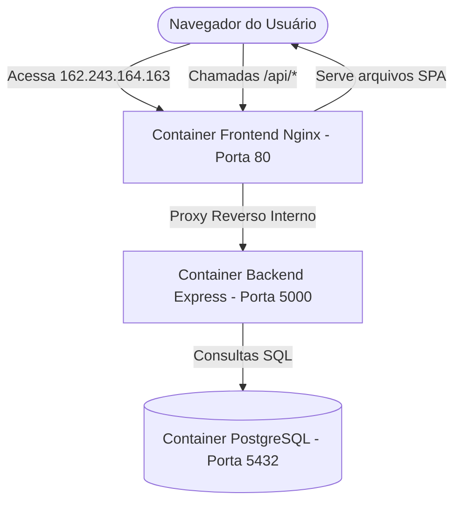

# 🚀 Guia de Deploy em Produção na VM
Este guia orienta o deploy completo da aplicação (React, Node.js/Express, PostgreSQL) na VM com o IP **`162.243.164.163`** utilizando a infraestrutura Docker que já configuramos e validamos.

Como a aplicação já está 100% conteinerizada e utilizando caminhos de rede dinâmicos/relativos (`/api`), ela é agnóstica a ambiente e rodará nativamente na sua VM sem necessidade de alterar nenhuma linha de código!

---

## 🏗️ Arquitetura de Rede em Produção
Quando a aplicação rodar na VM, o fluxo de comunicação funcionará assim de forma elegante:



---

## 🛠️ Passo a Passo do Deploy

### 1. Copiar os Arquivos da sua Máquina Local para a VM
Primeiro, precisamos transferir a pasta do seu projeto local para a VM. O método mais rápido e seguro é usar o `rsync` ou `scp`.

Abra um terminal na **sua máquina local** na pasta raiz do projeto (`Trabalho/`) e execute:

```bash
# Copiando via rsync (ignora pastas pesadas como node_modules)
rsync -avz --exclude 'node_modules' --exclude '.git' --exclude 'dist' ./ root@162.243.164.163:/var/www/taskflow
```
> [!NOTE]
> Se o seu usuário da VM não for `root`, substitua por `seu-usuario@162.243.164.163` e ajuste o caminho de destino (ex: `/home/seu-usuario/taskflow`).

---

### 2. Acessar a sua VM via SSH
Conecte-se no terminal da sua máquina virtual:
```bash
ssh root@162.243.164.163
```

---

### 3. Instalar o Docker e Docker Compose na VM (Caso não tenha)
Caso a sua VM ainda não tenha o Docker configurado, execute estes comandos rápidos na VM para instalar a stack oficial:

```bash
# 1. Atualizar os pacotes do sistema
apt update && apt upgrade -y

# 2. Instalar dependências iniciais
apt install -y ca-certificates curl gnupg lsb-release

# 3. Adicionar chave oficial do Docker
mkdir -p /etc/apt/keyrings
curl -fsSL https://download.docker.com/linux/ubuntu/gpg | gpg --dearmor -o /etc/apt/keyrings/docker.gpg

# 4. Adicionar o repositório oficial
echo \
  "deb [arch=$(dpkg --print-architecture) signed-by=/etc/apt/keyrings/docker.gpg] https://download.docker.com/linux/ubuntu \
  $(lsb_release -cs) stable" | tee /etc/apt/sources.list.d/docker.list > /dev/null

# 5. Instalar o Docker Engine e o plugin Compose
apt update
apt install -y docker-ce docker-ce-cli containerd.io docker-buildx-plugin docker-compose-plugin

# 6. Habilitar inicialização automática
systemctl enable docker
systemctl start docker
```

---

### 4. Construir e Iniciar a Aplicação na VM
Navegue até a pasta onde copiou o projeto na VM e suba a stack com o comando mágico:

```bash
cd /var/www/taskflow

# Executa o build de produção e inicia em segundo plano
docker compose up -d --build
```

---

### 5. Verificar a Integridade dos Serviços
Para garantir que tudo subiu e o banco de dados já aplicou as migrações com sucesso, rode:

```bash
docker compose ps
```
Você deverá ver todos os três containers ativos:
* `task_manager_frontend` -> Portas `80:80` (Up)
* `task_manager_backend` -> Portas `5000:5000` (Up)
* `task_manager_db` -> Portas `5432:5432` (Up - Healthy)

---

## 🎯 Acessando o Sistema
Uma vez inicializado, abra o seu navegador e acesse diretamente pelo IP público da VM:

👉 **`http://162.243.164.163`**

A aplicação carregará o frontend instantaneamente e fará as requisições para a API `/api` no mesmo IP de forma transparente e performática!
